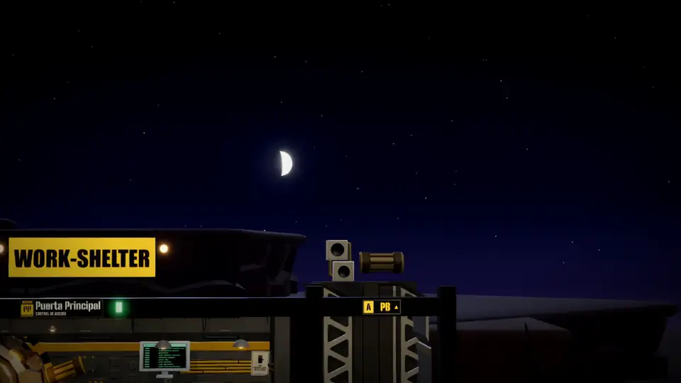

# work-shelter

> **[brunolab3](https://github.com/brunolab3)'s version, based on [DavidTorrijos/work-shelter-public](https://github.com/DavidTorrijos/work-shelter-public).**
> The original game is by **David Torrijos** (MIT licence, see [`LICENSE`](LICENSE)); this repo publishes my changes on
> top. Neither the original nor this repo takes pull requests or issues (see below): fork it and make it yours.

<p align="center">
  <a href="docs/media/trailer.mp4"></a>
  <br>
  <a href="docs/media/trailer.mp4"><b>▶ Watch the full trailer</b></a> (2 min, with sound)
</p>

**A playable underground shelter that is your work interface on top of [Claude Code](https://docs.claude.com/claude-code).**
Each repository is a room dug into the rock and its dwellers are real Claude Code sessions in that folder. You are the
Overseer: you walk corridors and elevators, talk to dwellers, approve permissions, open terminals and read your mail,
chats and calendar without leaving the shelter.

- **Everything on your Mac.** The server only listens on `127.0.0.1`, there's no telemetry and the game uses no API
  keys or inference of its own: dwellers work with **your** installed Claude Code, with your session, your settings,
  your `CLAUDE.md`, your hooks and your MCP servers.
- **It's a real game**: dwellers with routines and personalities, elevators, crops, a shooting gallery, a shop, a
  barber's to change looks… and everything is keyboard-driven.
- **Almost no setup**: on first launch you tell it where your repos live and each one becomes a room; integrations
  start off (no fake data) and the Vault opens so you connect yours. Spanish or English (Options → Language).

## What this is (and isn't)

work-shelter is **an initial proposal**: one possible way of working with coding agents if, instead of a list of tabs,
you had a place to move around, with people inside doing things. It works end to end, but it isn't a product and
doesn't try to be:

- **There's no roadmap or maintenance promise.** What's there is what it is. If something doesn't suit you, change it.
- **Make it yours.** Fork it and take it wherever you like: another style, another game on top, other integrations,
  an agent other than Claude Code, removing half the things. The licence is MIT precisely for that.
- **It's meant to be changed by an agent.** [`AGENTS.md`](AGENTS.md) describes the architecture for Claude Code and
  Codex, and the shelter itself has a room, the **Command Bridge**, whose dweller works on the game's repo: you ask it
  for a change from inside and apply it without closing anything.
- **The choices are debatable.** macOS only, shelter aesthetics, read-only integrations… They're choices of this
  version, not principles of the project (except the privacy and security ones, which are worth keeping: see below).

### No pull requests or issues

It's published for you to use and change, not as a community project: **pull requests and issues are neither read nor
accepted, and there's no support**. Nothing personal; it's the only way to share it without it becoming a second job.
If you improve it, publish it in your fork and tell people so others can find it: it'll be a pleasure to see it
spread.

### What's half-done

Two parts of the game are **an unfinished first iteration** and are left that way on purpose, open for whoever wants
to redo them their own way:

- **The shooting gallery** (`web/src/mundo/tiro.ts`, `ShootingRound` in `web/src/ui/Actividades.tsx`). The sight only
  moves horizontally (the height is fixed, that of the row of targets) and a hit is decided by comparing the sight's
  on-screen `x` with each target's, with a tolerance; there's no ray or depth. It shows: some shots that should land
  don't, and vice versa. The client computes the points and the server only bounds them (`juego.tiro` in
  `server/juego.ts`). Obvious ideas: a free two-axis sight with a `Raycaster` against the targets, targets at different
  heights and distances, and having the server receive the shots instead of the result.
- **The economy** (`server/juego.ts`, `shared/catalogo.ts`). The currency is scrap: each task a dweller finishes gives
  10–50 and sometimes a part for the field guide; tool calls make the crops grow; the gallery, the radio and the
  generator give a bit more; and the shop spends it on accessories, weapons and seeds. The pieces exist, the numbers
  add up and the server is the authority, but **it's not clear what it's for and it's dull**: no progression, nothing
  worth unlocking, no clear link between what you work on and what you get. It's there for someone to give it meaning
  (or remove it: the rest of the shelter doesn't depend on it).

If you redo either, the rest of the game only touches them through the protocol's `juego.*` actions and the shelter's
`jugador` state.

### What about Codex?

Today each dweller is a **Claude Code** session. Codex can already work *on* the game's code (it reads
[`AGENTS.md`](AGENTS.md), just like Claude Code), but it can't *be* a dweller: that's not done yet, and it's exactly the
kind of change the Command Bridge is for. The easiest way is to ask **Néstor**, its dweller (floor -1), as you'd ask
for anything else. For example:

> I want dwellers to be able to be Codex sessions as well as Claude Code, choosing the agent per room. Before touching
> anything, read AGENTS.md, inventory everything that depends on Claude Code today and propose a phased plan. The first
> phase: a Codex conversation in one room, with its permissions going through the game's dialog. Claude Code has to
> keep working exactly the same, and Codex must use my own session (no API keys).

Some tips:

- **Go in phases** and test each one before moving on: let it propose the plan, discuss it and approve phase by phase.
  After each, "Apply the game's changes" (interface) or "Restart the game" (server) from inside the shelter.
- **Commit before each phase** so you can go back if the shelter stops starting. If it breaks so badly you can't get
  in, open Claude Code or Codex in a terminal in the game's folder and ask from there.
- **Remind it what it mustn't lose**: nothing leaves your Mac except to the agent itself, you keep approving
  permissions, and conversations can be resumed outside the game ("go to the surface").
- You need Codex installed and signed in, just like Claude Code.

## Requirements

- macOS (Apple Silicon or Intel). Voice dictation needs macOS 26; everything else, any recent macOS.
- [Claude Code](https://docs.claude.com/claude-code) installed and signed in (`claude` and then `/login` in a
  terminal). Dwellers consume your plan's limits, as if you worked in the terminal.
- Optional: [`gh`](https://cli.github.com) signed in (pull requests, PR reviews, contributions and GitHub
  notifications) and iTerm (for "going to the surface"; without it, Terminal is used).

## Installation

Paste this in a terminal:

```bash
curl -fsSL https://raw.githubusercontent.com/brunolab3/my-work-shelter/main/instalar.sh | bash
```

It takes a few minutes the first time and at the end you have **work-shelter in Applications**, with its icon and
pinned to the Dock; from then on it opens like any app. What it does ([`instalar.sh`](instalar.sh), read it first if
you like):

- Downloads the game into `~/.work-shelter-public` (another folder: `SHELTER_CODIGO=/path` before `bash`). If macOS has
  no git, it opens the command line tools installer and asks you to rerun the command when it's done.
- Uses Node 22 or later; if it can't find one, it downloads a portable one for the game (checking its official
  checksum).
- Installs the dependencies (`npm ci`) and the game window (Electron), downloads the CC0 art (about 100 MB, pinned by
  commit) and builds the interface.
- Creates `/Applications/work-shelter-public.app`, pins it to the Dock and opens it. To leave the Dock alone:
  `… | bash -s -- --sin-dock`.

It asks for no password and installs nothing outside those folders (if your macOS user isn't an administrator and
can't write to `/Applications`: `… | bash -s -- --destino ~/Applications/work-shelter-public.app`). The app isn't
signed by any developer: your own Mac creates it at install time, so macOS opens it without warnings.

**Already have David Torrijos's original installed?** Both use the same folder, app and port, so running this command
would just update the original. Quit the game, move it aside (`mv ~/.work-shelter-public ~/.work-shelter-original`)
and run the command; to keep your shelter, copy `~/.work-shelter-original/.data` into `~/.work-shelter-public`
before opening it.

**Updating:** run the same command again (if you've changed the game's code, it won't overwrite it).

**Uninstalling:** delete `/Applications/work-shelter-public.app` (and remove it from the Dock), `~/.work-shelter-public`
(the game and the shelter's state), `~/Library/Application Support/work-shelter-public` (special rooms' folders,
browser sessions and any example repos from older versions) and `~/Library/Logs/work-shelter-public`. Integration
credentials are in the keychain (Keychain Access, search `work-shelter-public`). Your repos and your Claude Code
conversations aren't touched.

### From source

If you're going to change the game, you can keep it wherever you like:

```bash
git clone https://github.com/brunolab3/my-work-shelter.git work-shelter && cd work-shelter
./shelter                 # prepares whatever's missing and opens the game (Ctrl+C here closes everything)
./shelter instalar-app    # or creates the Applications app pointing at this folder (--sin-dock to leave the Dock alone)
```

The app opens the game from the folder it was installed from, so your changes show without reinstalling: the game's
own Command Bridge applies them ("Apply the game's changes" or "Restart the game"). The icon is
`electron/icono/fuente.png`; if you change it, `node scripts/instalar-app.mjs --icono` prepares it again (needs
`npx playwright install chromium`).

Closing the window asks for confirmation and stops all sessions. If you reload, nothing is lost: the server waits 20
seconds for you to come back before stopping the sessions.

## First launch

You choose the Overseer's look, the shelter's name and your **repos root**, pre-filled with the folder it guesses
(`~/Sites`, `~/Developer`, `~/Projects`, `~/code`… the first that exists). Then:

- **Every git repo directly inside the root becomes a room**, plus **wings** (folders without git that contain several
  repos: a coordination room with all of them in view). No example repos are cloned. If you change the root later (in
  the Vault), the new root's repos come in and rooms whose folder is outside it are retired (except rooms where someone
  is working, and the service rooms). With the root at `~` nothing is added automatically. Other folders keep showing
  as suggestions at the **Main Gate**, where you recruit more rooms. From a **room's panel** (E next to it) you can
  link it to another folder or retire it.
- Opening the shelter takes you to the **Vault** to connect your mail, chats, calendar and boards (see
  [Integrations](#integrations)); until you do, they stay off.
- Each repo room gets the stock scene for its type (Studio for web and Node, Laboratory for Python, Foundry for Rust
  and Go, Archive for no code, Workshop for the rest). **Adapt the room to the repo** (room panel or ⌘K): its dweller
  reads the repo and designs it a scene of its own with the game's props (the centrepiece, furniture and gadgets,
  signs with slogans, self-typing screens, colors and light), looks at it with a photo, fixes it and tells you what it
  built. Then you can ask for touch-ups in the same conversation ("put a plant by the desk"), or go back to the stock
  scene. The scene is data the game validates, never code: see [`docs/decorados.md`](docs/decorados.md).
- The service rooms: the Command Bridge (the game's own repo), the Vault (integrations and settings), Communications,
  Calendar, Planning (where you start: your Jira tasks with their PRs), Logistics, Version Control (git and GitHub), the
  Main Gate, Hydroponics, Disco, Shooting Gallery and Body Shop (change looks).

## Controls

Everything is in the game with **F1**, and each thing's keys show in the top bar.

| Key | What it does |
|---|---|
| WASD / arrows | run (with Shift, walk); the camera follows the Overseer; on the landing, W/S go up and down by elevator |
| E / Enter | talk, use a device, choose |
| click | go somewhere; click a dweller: go and talk |
| wheel, Z, − / = | zoom, overview, room view |
| M | map: fast travel and rearranging rooms |
| Tab | what's going on: who's working, who's waiting for you, notices, next event |
| Q | go straight to the first dweller waiting for you |
| T | the room's real terminal (shell on a PTY) |
| R | notebook: full transcript of a conversation |
| I | backpack: inventory, field guide, shop and records |
| N / C / L | go to Communications, Calendar or Planning |
| G | git client |
| P | Body Shop: change looks (yours or a dweller's) |
| ⌘K | finder, from anywhere: conversations, actions, dwellers and rooms |
| Esc | closes what's open; in the shelter, the game menu (options, shortcuts, restart, go out) |

In a conversation: Enter sends (Shift+Enter, new line); `/` opens Claude Code's commands and `/btw` asks a side
question without interrupting; Ctrl+C (or `/stop`) stops the dweller; ⌘U or dragging attaches files; ⌘D dictates
(macOS transcribes on your Mac, without network); 1 / 2 / 3 on a permission: allow, always allow in this session, deny.

## What's in the shelter

- **Repo rooms**: branch, changes, last commit, dwellers and activity, and each open conversation's context and token
  usage. Open the folder in Finder, the editor or Terminal, see the history, retire the room.
- **Dwellers**: real Claude Code sessions. Start a job (model, effort, permission mode, worktree), resume conversations
  from that folder (including terminal ones), approve permissions seeing the exact command or diff, answer questions
  and approve plans, interrupt. Several jobs at once, each in its tab. Each conversation shows how much of the context
  window it uses and the tokens spent.
- **Helpers**: subagents show up as robots in the room whose files they touch.
- **Holographic copies**: worktrees, as holograms of whoever works inside, in their task's color. Merge or discard
  from their panel.
- **Visitors**: a Claude Code session open outside the game (a terminal, the Claude app) in that folder or one of its
  worktrees shows up as a combat robot (in the task's color if it's a task worktree); E brings it back in.
- **Logistics**: plan a Jira task with every repo in view and split it across rooms. Its dweller proposes a plan per
  repo; once approved, each part starts in its repo's room, in its own worktree with the task key in the branch. The
  plan is shared: parts read it, Logistics updates it and notifies the affected rooms, and a messenger robot carries
  each delivery. Each task has a color you see on boards, screens and holograms. Its big screen is the **deployment
  plan**: your PRs by state, with blockers as arrows and the order they can be merged in; PRs of the same task are
  grouped in a block of its color in each column.
- **Planning**: your Jira tasks by state with their PRs (from GitHub), ready to plan with P. **Organize by tasks**
  (a repo room's panel, or ⌘K for all rooms) gives each task with PRs its own worktree and conversation.
- **Reviews of your PRs**: with GitHub connected, every minute new reviews and comments from others on your open PRs go
  to the conversation working that branch (or its task's worktree); the dweller proposes what to fix and reply and
  waits for your approval. Each delivery shows a notice.
- **Version Control**: git client for every repo in the shelter (stage by files, hunks or lines, commit, push,
  branches, stash) and, with GitHub connected in the Vault, your pull requests (yours and those awaiting your review,
  Pull requests tab) and your contribution matrix (otherwise, the matrix of your local commits and no PRs).
- **Command Bridge**: the game's own repo. Its dweller evolves the game from inside; "Apply the game's changes"
  rebuilds the interface without cutting sessions.
- **Disco**: the DJ booth opens Spotify, which plays inside the game (in a windowless Google Chrome: you need it
  installed and a Spotify account); the deck at the bottom left (⌘J) controls it without opening it. Without Spotify,
  the room's own music plays.
- **Activities and economy** (first iteration, see [What's half-done](#whats-half-done)): the currency is scrap and it
  comes from real work (each finished task gives scrap). Crops that grow with each tool dwellers use, a shooting
  gallery with records, a shortwave radio and the generator panel; in the shop, accessories for you and the dwellers.
- **Going to the surface**: if the game crashes or shouldn't be seen, conversations and terminals carry on in a
  terminal on your desktop ([`docs/superficie.md`](docs/superficie.md)).
- **To your phone**: 📱 in the intercom (or ⌘K) sends one conversation to Remote Control, and "Everything to your
  phone" (Esc → Leave the shelter, or ⌘K) sends all, to continue from the Claude app or claude.ai/code while running on your Mac. A
  repo room can also keep its own Remote Control server on.
- **Slack remote control** (optional, with your own Slack app): approval requests arrive by direct message to answer
  yes/no from your phone, and writing to the bot lists the open conversations to send them to Remote Control. It never
  sends what's said ([`docs/superficie.md`](docs/superficie.md#slack-remote-control)).

## Integrations

A new shelter starts with every source **off**: nothing is read and there's no simulated data, not even from the
sources that need no setup (Mac Mail and Calendar, GitHub through `gh`). When you open the shelter for the first time
you land in the **Vault**, where each source has a step-by-step guide, "Test connection", "Use real data" and, to
try the game first, "Switch to DEMO" (simulated data, marked DEMO):

| Source | What it brings | What you need |
|---|---|---|
| **Google (Gmail and Calendar)** | unread mail and calendar | an OAuth client of type "Desktop app" in Google Cloud |
| **Mac Mail** | unread mail (Gmail or any other account) | the account added in Internet Accounts and Mail open: nothing in Google Cloud |
| **Mac Calendar** | the calendars you have in the Calendar app (Google, Exchange, iCloud…) | Calendar open: nothing to create |
| **Discord** | messages from the channels you choose and your mentions | your own bot (never your account token) |
| **Slack** | messages from your channels, DMs and mentions | your own app with a bot or user token |
| **GitHub** | notifications (reviews, mentions, assignments, CI); your PRs and their reviews | the `gh` session or a classic token with `notifications` |
| **Jira** | your tasks for the Planning board and Logistics | your site, email and an API token |

**Microsoft 365 (Outlook)** and **Linear** are also implemented but switched off in this version (`desactivada` in
`shared/fuentes.ts`; remove the flag to turn them back on).

Everything is **read-only outwards** with minimal permissions: the game doesn't reply to mail or chats or create
events. The only writes are Linear (when on, through the conversation with the Planning dweller and with your
permission), git push/pull/fetch from the git client (only with your button) and the Slack remote control's own
messages. The repo ships nobody's client IDs or credentials. Secrets are stored in the **macOS keychain** (service
`work-shelter-public`), never in the repo or the game's data. Technical details, fields, Logistics and the Linear MCP
setup for Claude Code and Codex: [`docs/integraciones-uso.md`](docs/integraciones-uso.md).

## Privacy and security

> **Use it at your own risk.** work-shelter is published as is, without warranty of any kind ([MIT](LICENSE)). It
> drives agents that run commands on your Mac with your permissions, stores credentials for your services and opens
> browsers with your sessions. Nobody has audited its security or commits to fixing anything: whatever happens to your
> machine, your data or your accounts (or your organisation's) is on you. Review the code before using it with anything
> you care about. Precautions and known risks: [`SECURITY.md`](SECURITY.md).

- The server only listens on `127.0.0.1`, checks `Host` and `Origin` and requires a per-start secret (it goes in the
  `#t=` of the address `./shelter` opens, never in the page).
- No telemetry or analytics. The network is only used for what you configure (the integrations) and to download
  dependencies and assets the first time.
- **Folder trust, as in the CLI**: if a repo ships Claude Code config (`.claude/`, `.mcp.json`, `CLAUDE.md`) and you
  haven't accepted it in Claude Code, the game asks before loading it: this time, always for that folder, or work
  without it (without its hooks, MCP servers, permissions or instructions).
- Permissions are shown with the exact command or diff, as text (uninterpreted), invisible characters included.
- **Dwellers are Claude Code with your permissions**: what you approve runs on your Mac. The "skip permissions" mode
  exists because it exists in Claude Code; use it only in folders you don't mind losing.
- Don't link as a room, or keep in your repos root, folders you don't trust, and bear in mind that `npm run dev`
  (development) serves the game folder's files, including its secret, to any local process: more in
  [`SECURITY.md`](SECURITY.md#known-risks).

## Data

- Shelter state: `.data/refugio.json` in the game folder (`~/.work-shelter-public` if you installed with the command
  above): rooms, layout, dwellers, settings, language, progress, records, seen notices. Resetting the shelter from the
  Vault doesn't touch your folders or your credentials.
- Special rooms' folders (and example repos from older versions): `~/Library/Application Support/work-shelter-public/`.
- Conversations: where Claude Code keeps them (`~/.claude/projects`).
- Secrets: macOS keychain, service `work-shelter-public`.

## Development

```bash
npm run dev                      # interface with hot reload (http://127.0.0.1:5173)
node server/supervisor.mjs       # server with restart from the game (SHELTER_DATOS=/tmp/x to leave your data alone)
npm test                         # tests (no network: integrations are tested with synthetic fixtures)
npx tsc --noEmit -p .            # types
node scripts/captura.mjs <url> <png> 1600 900 --pasos=40   # screenshots for visual QA
```

Useful variables: `SHELTER_DATOS` (alternative data folder), `SHELTER_PUERTO` (a port other than 3778),
`SHELTER_ZONA` (time zone, the system's by default), `SHELTER_TERMINAL=terminal|iterm`.

### Code map

| Folder | What's there | Where to start if you want… |
|---|---|---|
| `server/` | local server (Node): shelter state, Claude Code sessions with the Agent SDK, PTY terminals, worktrees, git, planning, PR reviews, economy and integrations | to change the agent: `sesiones.ts`; a new source: `integraciones/` and [`docs/integraciones-uso.md`](docs/integraciones-uso.md) |
| `shared/` | what server and client share: protocol, texts in both languages, shop catalogue, recruit templates, initial layout, looks and set dressings | other initial rooms: `refugioInicial.ts`; another shop: `catalogo.ts`; a text: `textos/` |
| `web/src/motor/` | Three.js: scene, materials, textures, camera | another visual style |
| `web/src/mundo/` | the 3D shelter: rooms, dwellers and their routine, helpers, visitors, holograms, sky | a new room: `salas/`; another routine: `habitante.ts` |
| `web/src/ui/` | the React interface: top bar, intercom, terminals, browsers, devices, git client | a device or an activity: `Actividades.tsx` |
| `electron/` | the game window, the embedded browsers and Spotify's windowless Chrome | |
| `scripts/` | startup, app install and end-to-end QA (`qa-*`) | |

The architecture is in [`AGENTS.md`](AGENTS.md) (instructions for agents; `CLAUDE.md` imports it),
[`docs/diseno-refugio.md`](docs/diseno-refugio.md) and [`docs/assets.md`](docs/assets.md). The `scripts/qa-*` scripts
are end-to-end tests with Playwright; those that launch real Claude Code sessions say so in their header (use them
with a test shelter).

## Troubleshooting

- **"Can't find Claude Code".** Install it and sign in with your account. Then reopen work-shelter.
- **Port 3778 is busy.** Maybe another work-shelter is already open. Close it or start with
  `SHELTER_PUERTO=3779 ./shelter`.
- **It's slow.** There's a single graphics profile, at 60 fps max. With the game window behind another app it doesn't
  draw anything: terminals and sessions keep going.

## Licences and credits

- **Code**: [MIT](LICENSE). Parts of the sessions, terminals, tools and worktrees core are adapted from
  [code-town](https://github.com/JuanLouTech/code-town) (MIT; see [`LICENSES/code-town-MIT.txt`](LICENSES/code-town-MIT.txt)).
- **3D art**: [KayKit](https://kaylousberg.com) (Kay Lousberg) and [Quaternius](https://quaternius.com), CC0;
  provenance in [`docs/assets.md`](docs/assets.md). The Version Control Octocat is a community model licensed CC-BY
  4.0 ([`LICENSES/octocat-CC-BY-4.0.txt`](LICENSES/octocat-CC-BY-4.0.txt)); the Octocat character and brand belong to
  GitHub, Inc.
- **Sound**: CC0 and own synthesis; sources in [`LICENSES/AUDIO.md`](LICENSES/AUDIO.md).
- **Fonts**: OFL, included in `web/public/fuentes`.
- **Trailer** (`docs/media/`): real game footage; music "AI Fight" by Alexander Ehlers
  ([T & T Free Cyberpunk Pack 2](https://opengameart.org/node/119238), CC0), and the game's own CC0 effects.
- **Sky astronomy**: a minimal version of [SunCalc](https://github.com/mourner/suncalc) (BSD-2-Clause; see
  [`LICENSES/suncalc-BSD-2-Clause.txt`](LICENSES/suncalc-BSD-2-Clause.txt)).

work-shelter is an independent project: it's not affiliated with or endorsed by Anthropic, GitHub, Microsoft, Google,
Discord, Slack, Linear, Atlassian or the authors of the games that inspire it. Names and trademarks belong to their
owners.
